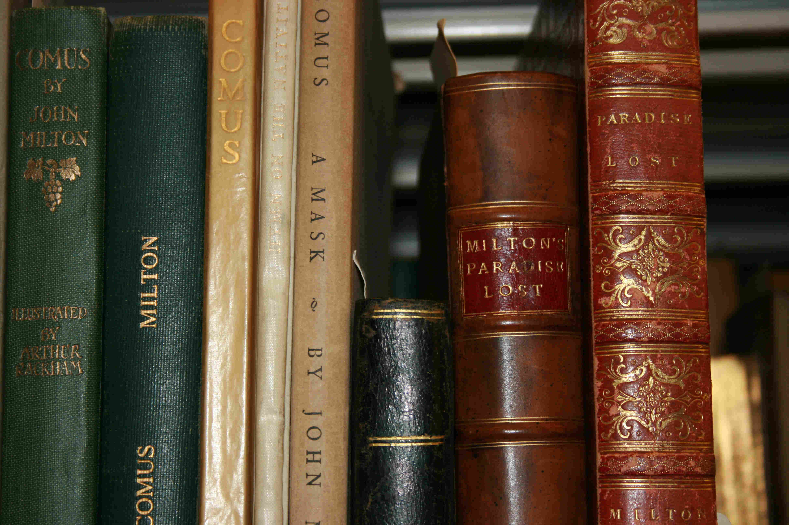

Le mercredi 29 novembre, j'ai participé à une session unique de 90 minutes offerte par Woodbrooke, animée par Rhiannon Grant, sur le thème des livres de Foi et Pratique quakers britannique et d'autres livres de discipline de la même tradition. J'étais intéressé pour un certain nombre de raisons. Les efforts entrepris par les Amis francophones pour traduire certaines parties du livre canadien de Foi et Pratique me préoccupent, mais je suis également conscient de la nécessité d'ajuster le texte pour mieux refléter les pratiques quakers modernes, par exemple dans le domaine de l'identité de genre et de la nécessité de mieux prendre en compte l'approche non théiste du quakerisme. Toutes ces questions ont été abordées au cours de la session à laquelle ont participé une vingtaine de personnes en ligne, presque exclusivement britanniques. Rhiannon est membre du comité de révision du Livre de discipline de l'Assemblée annuelle de Grande-Bretagne (BYM) pour la foi et la pratique quaker. Depuis 2018, un processus de révision majeure est en cours, avec l'espoir de l'achever d'ici 2030.

Rhiannon a donné un bref aperçu du document britannique actuel, qui est [entièrement disponible en ligne](https://qfp.quaker.org.uk/), en précisant qu'il contient de nombreuses sections différentes et beaucoup de matériel. Seule une partie du document est basée sur des témoignages personnels ; une grande partie est dérivée des procès-verbaux de l’Assemblée de Grande-Bretagne. De plus, sa mise à jour nécessite l'approbation de l’Assemblée de Grande-Bretagne, même pour les plus petits éléments. Dans le cadre du processus de révision, on s'efforce de séparer les sous-sections en documents distincts pour les textes qui ne nécessitent pas l'approbation complète de l'assemblée générale ordinaire, afin alléger la charge de travail de cette assemblée. Le document commence par des "conseils et questions", puis traite de ce que l'on appelle le "gouvernement de l'église", avant d'aborder plusieurs chapitres sur l'appartenance à l'église et les responsabilités qui y sont associées, suivis de chapitres détaillés sur l'engagement social, y compris le témoignage pour la paix, un appel à l'unité avec le monde naturel et un engagement en faveur de la diversité.

Un aperçu de l'histoire des livres de discipline quakers a ensuite été présenté, centré sur le regroupement des conseils dans un [folio manuscrit relié en 1738,](<https://quakerstrongrooms.org/2018/04/24/quaker-faith-and-practice-the-quaker-book-of-discipline-from-the-green-dragon-of-the-ancients-to-the-red-book/>) qui a été copié et distribué dans toute l'Angleterre. La première édition imprimée date de 1782 et s'intitule Extracts from the minutes and advices of the Yearly Meeting of Friends (Extraits des procès-verbaux et des conseils de l'Assemblée annuelle des Amis) et publiée par l'assemblée annuelle de Londres.  L'année suivante, elle a été révisée, et des révisions ont été entreprises sporadiquement pendant les années qui ont suivi. En 1861, le document fut révisé structurellement en trois parties qui sont devenues des volumes distincts : la doctrine chrétienne, la pratique chrétienne et le gouvernement de l'église. En outre, au cours des décennies suivantes, des témoignages individuels ont commencé à y être introduits. Ils n'ont cependant pas été systématisés avant l'édition de 1921. En 1995, Foi et Pratique quakers a été achevé dans sa forme actuelle. C'est à cette époque que la London Yearly Meeting a été rebaptisée Britain Yearly Meeting afin que cette dernière puisse être citée en lieu et place de la première, ce qui était devenu un problème pour d'autres assemblées de la région britannique. Il en est actuellement à sa cinquième édition, ce qui indique qu'un certain nombre de révisions supplémentaires ont été publiées depuis 1995.

Rhiannon a également présenté les livres d’autres assemblées annuelles de plusieurs époques et dans plusieurs régions. A ce stade, j'avais déjà mentionné que je venais du Canada et que nous envisagions non seulement la possibilité de réviser notre Foi et Pratique mais aussi de développer une traduction française de l'ouvrage. Rhiannon a souligné le fait que certaines parties sont traduites en gallois et que des discussions sont en cours avec les réunions galloises concernant l'exercice de révision en cours. Elle a proposé de me mettre en contact avec des quakers gallois afin que je puisse discuter de ces questions avec eux.

Elle nous a présenté le document [Faith and Practice de l’Assemblée de Philadelphie](https://qhpress.org/texts/obod/) datant de 1806 qui comprend de nombreux points non pertinents aujourd'hui (serments, diffamations, etc.) et d'autres qui sont communs aux deux contextes et aux deux époques (mariages, enfants, assemblées annuelles, etc.). Le document de 1806, comme les documents britanniques antérieurs, aborde également des questions telles que l'esclavage, qui, bien entendu, ont radicalement changé depuis lors. Elle nous a également montré un document moderne intitulé [Faith and Practice for Illinois Yearly Meeting](https://Ilym.org/ilym/faith-and-practice) qui est structuré différemment du document britannique ainsi qu'un document publié par le Central and South Africa Yearly Meeting, intitulé [Living Adventurously](<https://quakers.co.za/wp-content/uploads/2014/04/Living-Adventurously.pdf>) qui diffère considérablement des autres documents en offrant beaucoup d'informations contextuelles sur les pratiques des Quakers en Afrique. Un autre participant a parlé du livre de discipline australien intitulé This We Can Say : Australian Quaker Life, Faith and Thought, qui est bien conçu et comprend des éléments visuels tels que des dessins et des œuvres d'art, ainsi que des partitions musicales.

La session s'est terminée par une discussion sur les procédures relatives aux [révisions en cours](https://www.quaker.org.uk/resources/quaker-faith-and-practice/revising-quaker-faith-practice). Le comité sollicite des suggestions par le biais d'un formulaire en ligne et a également sondé les assemblées britanniques, ce qui lui a permis de dresser une longue liste de domaines à traiter. En réponse à une question que j'ai posée sur la question des non-théistes, Rhiannon a indiqué que la question la plus importante et la plus controversée transmise à la commission de révision par les assemblées mensuelles était précisément celle-là. Il s'agit d'une discussion en cours ; globalement, le consensus est qu'il y a une place pour les non-théistes dans la diversité du quakerisme moderne, mais la manière de formuler la question dans le texte révisé fait encore l'objet d'un débat.

La session a mis en lumière plusieurs aspects de la préparation de ces livres de discipline quaker que j'ai trouvés utiles, ainsi que le processus de révision. Il semble qu'il existe de nombreuses approches différentes à travers le monde ; notre livre de Foi et Pratique canadien en représente une parmi d'autres. En effet, il est très différent à plusieurs égards de son équivalent britannique, qui est moins axé sur le témoignage individuel que le nôtre. Je suis certain que tout effort de révision dans le contexte canadien visera à respecter le document existant et les traditions qu'il incarne, mais je pense qu'un examen attentif d'autres exemples à travers le monde peut s'avérer utile, surtout si nous cherchons, comme cela semble probable, à renforcer dans ses pages la représentation de nos membres francophones et de leurs pratiques.
